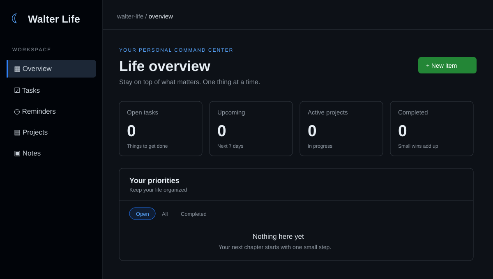

<div align="center">

# 🌙 Walter Life

**Your personal command center for the things that matter.**

A clean, GitHub-inspired dark-mode dashboard to organize your tasks, reminders, projects, and notes — built with **C#**, **Blazor**, and simple **JSON file storage**.


</div>

---

## 🖥️ Dashboard preview



> **Preview illustration:** This image depicts the implemented dashboard layout and empty state. It is **not** a verified screenshot from a running build. Actual screenshots can replace it after the app is launched and tested.

## ✨ Features

| | Feature | What it does |
| :--: | --- | --- |
| 📊 | **Life overview** | See open tasks, upcoming due dates, active projects, and completed items. |
| ✅ | **Tasks** | Capture to-dos and mark them complete. |
| ⏰ | **Reminders** | Track important things you don't want to forget. |
| 🗂️ | **Projects** | Keep larger goals visible and organized. |
| 📝 | **Notes** | Save ideas and useful information in one place. |
| 🔎 | **Search & filters** | Find items by text and switch between open, completed, and all. |
| 🏷️ | **Priorities & categories** | Add context, urgency, and optional due dates. |
| 🌙 | **Dark interface** | GitHub-inspired colors, subtle borders, and a responsive layout. |

## 🔁 Recurring items

When creating or editing an item, select a repeat interval: every **N days, weeks, months, or years** (1–365). Completing a recurring item moves its due date to the next future occurrence and keeps it open. One-time items still complete normally. This is in-app scheduling, not push notifications.

## 🧰 Tech stack

- **Backend:** C# / ASP.NET Core
- **UI:** Blazor Server with interactive components
- **Database:** Local JSON file (no SQL server required)
- **Styling:** Custom CSS with GitHub-inspired dark colors
- **Target framework:** .NET 8

## 🚀 Getting started

**Prerequisite:** Install the [.NET 8 SDK](https://dotnet.microsoft.com/download/dotnet/8.0).

1. Clone the repository:

   ```bash
   git clone https://github.com/1x4x/walter-life.git
   cd walter-life
   ```

2. Restore dependencies and start the app:

   ```bash
   dotnet restore
   dotnet run
   ```

3. Open the local URL printed in the terminal.

> The project has not yet been compiled or tested in a running environment. If you encounter a build issue, please open an issue in this repository.

## 📁 Project structure

```text
walter-life/
├── Components/
│   ├── Pages/
│   │   ├── Home.razor         # Dashboard and item management
│   │   └── Error.razor
│   ├── App.razor
│   ├── Routes.razor
│   └── _Imports.razor
├── Models/
│   └── LifeItem.cs            # Task/reminder/project/note model
├── Services/
│   └── LifeStore.cs           # JSON persistence
├── docs/
│   └── dashboard-preview.svg  # Illustrative preview
├── wwwroot/
│   └── app.css                # GitHub-style dark theme
├── Program.cs
└── WalterLife.csproj
```

## 💾 How JSON storage works

Walter Life automatically creates and saves data in:

```text
App_Data/life.json
```

- The file is stored **on the server**, not in the browser.
- The `App_Data/` directory is excluded from Git by `.gitignore`.
- Use a **persistent writable disk** when hosting, or data may disappear after a redeploy.
- This initial implementation is intended for **one private workspace**, not multiple independent users.

## 🔐 Important security note

**Authentication is not implemented yet.** Anyone who can reach a deployed instance can view and modify the same personal information. **Do not deploy it publicly with sensitive data.** Run it locally or protect the entire site behind private access until login and authorization are implemented.

## 🗺️ Roadmap

- [x] GitHub-inspired dark-mode UI
- [x] Tasks, reminders, projects, and notes
- [x] Search, filtering, and item editing
- [x] JSON file persistence
- [ ] Authentication and user accounts
- [x] Configurable recurring items
- [ ] Notifications
- [ ] Calendar and timeline views
- [ ] Backup and restore
- [ ] Automated build and UI tests
- [ ] Real application screenshots

---

<div align="center">

**☾ Walter Life** — Make room for what matters.

</div>
